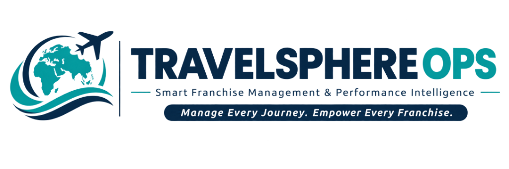

# TRAVELSPHERE OPS
### Smart Franchise Management & Performance Intelligence

> **Manage Every Journey. Empower Every Franchise.**



TRAVELSPHERE OPS is an enterprise-grade tourism franchise operations and intelligence management platform. It combines automated operational workflows, multi-tier data scoping, role-based access control (RBAC), and an intelligent AI assistant into a unified single-pane interface for tourism franchise networks.

---

## Key Capabilities

- **Enterprise Four-Role Access Control (RBAC):** Strict data scoping and capability routing across **Super Admin**, **Franchise Owner**, **Branch Manager**, and **Staff**.
- **Four-Level Data Isolation:** Backend-enforced database queries ensuring multi-franchise and cross-branch data privacy with automatic `403 Forbidden` protection.
- **Consolidated 9-Module Architecture:** 3 functional groups covering network operations, business execution, and AI intelligence.
- **Role-Aware TravelSphere AI Assistant:** Contextual conversational agent powered by live SQLite operational records and authenticated user permissions.
- **Franchise Partner Onboarding & Approval Queue:** Public application submission with Head Office authorization workflows.

---

## Role & Data Scope Matrix

| Role | Responsibility | Data Access Scope | Authorized Outlets |
| :--- | :--- | :--- | :--- |
| **Super Admin** | Head Office Administrator | Global Network | All Franchises & All Regional Outlets |
| **Franchise Owner** | Multi-Branch Franchise Partner & Principal | Franchise Level | Governed Franchise Branches (e.g. Mumbai & Pune) |
| **Branch Manager** | Physical Branch Operations Manager | Branch Level | Assigned Physical Branch (e.g. Mumbai Hub) |
| **Staff** | Travel Consultant & Booking Specialist | Personal Level | Assigned Bookings & Duty Shift Tasks Only |

---

## Consolidated Navigation Structure

### 1. Overview
- **Dashboard (`/dashboard`):** Personalized command centers with tailored KPIs, revenue velocity, and shift tracking for each role.
- **Franchise & User Management (`/franchise-management`):**
  - *Franchise Directory:* Outlet hierarchies, territory licenses, and principal records.
  - *User Management:* System-wide user roster, status toggling (Active/Inactive), and new staff provisioning.

### 2. Operational Agents
- **Finance & Branch Performance (`/finance-performance`):** Branch revenue vs. target tracking, financial cash-flow analysis, and exportable CSV reports.
- **Bookings & Travel Resources (`/booking-resources`):** Tour package catalog, itinerary management, direct booking engine, and vendor partner agreements.
- **Workforce & Tasks (`/workforce`):** Employee directory, attendance shift punch clock, prioritized task board, and personal staff task views.
- **Customer & Marketing (`/customer-marketing`):** Customer CRM, travel history, promotional campaigns, discount vouchers, and client feedback.

### 3. AI Intelligence & System
- **Franchise Intelligence & Compliance (`/franchise-intelligence`):**
  - *AI Insights:* Automated anomaly detection, trend forecasting, and operational recommendations.
  - *Audit & Compliance:* Standard Operating Procedure (SOP) compliance checklists and license audits.
  - *Approval Queue:* Head Office review queue for pending franchise and manager onboarding requests.
- **TravelSphere AI Assistant (`/ai-assistant`):** Dedicated natural-language operations assistant scoped to live operational records.
- **Notifications & Activity Log (`/notifications`):** Real-time booking alerts, duty rosters, and compliance notices.

---

## Development Demo Accounts

The platform includes four pre-seeded accounts for evaluation:

| Role | Email | Password | Scope / Territory |
| :--- | :--- | :--- | :--- |
| **Super Admin** | `admin@travelsphere.demo` | `Admin@123` | Global Network (Head Office) |
| **Franchise Owner** | `owner@travelsphere.demo` | `Owner@123` | West Coast Tourism Holdings (Franchise #1) |
| **Branch Manager** | `manager@travelsphere.demo` | `Manager@123` | Mumbai Branch (Branch #1) |
| **Staff** | `staff@travelsphere.demo` | `Staff@123` | Mumbai Branch (Personal Desk) |

---

## Technology Stack

- **Frontend:** React 18, Vite, Tailwind CSS, React Router DOM v6, Lucide React, Recharts, Axios
- **Backend:** FastAPI, Uvicorn, Python 3.10+, PyJWT, Bcrypt, SQLite3
- **Design System:** Deep Navy (`#142B4A`), Teal (`#0F9D9A`), Light Slate (`#F5F7FA`)

---

## Setup & Running Locally

### 1. Clone Repository
```bash
git clone https://github.com/VennelaEddum/TravelSphere-Ops.git
cd TravelSphere-Ops
```

### 2. Backend Setup
```bash
# Install Python dependencies
pip install -r requirements.txt

# Initialize & Migrate Database
python database/create_tables.py
python database/seed_data.py
python database/create_auth_tables.py
python database/migrate_four_roles_hierarchy.py

# Start FastAPI Backend Server
python -m uvicorn backend.server:app --host 127.0.0.1 --port 8000 --reload
```
The backend API documentation is available at `http://127.0.0.1:8000/docs`.

### 3. Frontend Setup
```bash
cd frontend

# Install Node dependencies
npm install

# Start Vite Development Server
npm run dev
```
Open `http://localhost:5173` in your browser.

---

## Verification & Automated Tests

Run backend RBAC and isolation tests:
```bash
python test_api_direct.py
```

Run frontend capability and unit tests:
```bash
cd frontend
node test_runner.mjs
```

Build production bundle:
```bash
cd frontend
npm run build
```

---

## License

Proprietary enterprise tourism management platform developed for TRAVELSPHERE OPS. All rights reserved.
